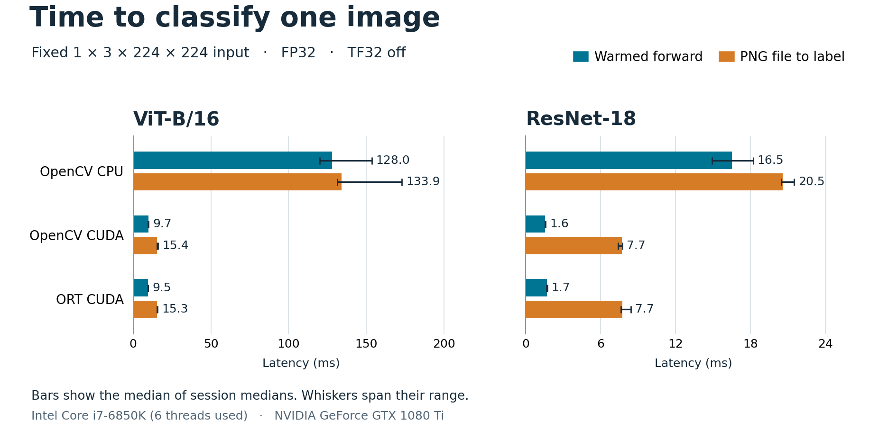
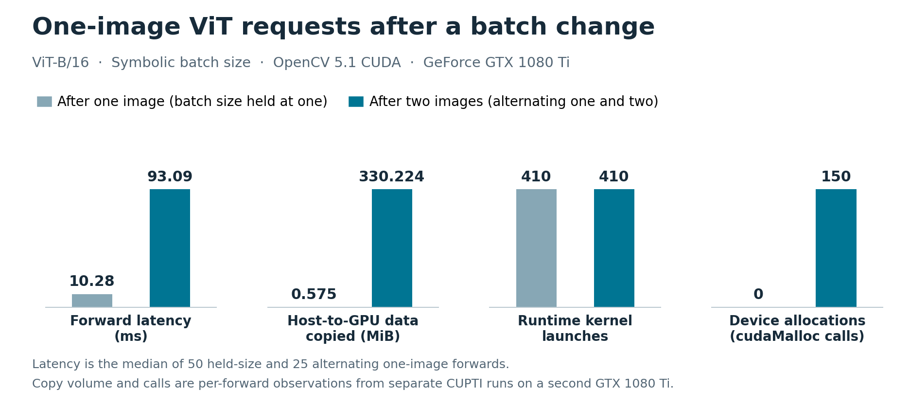

# OpenCV 5.1 DNN on the GPU: When Does CUDA Actually Help?

Suppose you have trained an image classifier in PyTorch and want to use it in an OpenCV application. Your program needs to open a photo, prepare the pixels, run the model and return a label. How much faster would that program become if the model ran on an NVIDIA GPU?

## From a trained PyTorch model to an OpenCV prediction

After training a model in PyTorch, you often export it to a format such as **ONNX** to use it in another program. An ONNX file contains the **weights**, the numbers learned during training, and a description of the calculations needed to make a prediction. OpenCV can load that file and use it to classify a new image. [PyTorch’s ONNX export tutorial](https://docs.pytorch.org/tutorials/beginner/onnx/export_simple_model_to_onnx_tutorial.html)

Running a trained model on new input is called **inference**. For an image classifier, that means supplying a photo and getting a predicted category back.

In computer vision, **convolutional neural networks (CNNs)** have long been a common choice. A CNN applies small filters across an image to find patterns. Its early layers can respond to edges and textures. Later layers combine those patterns into features that help recognize objects.

**Vision transformers** have also become widely used. A vision transformer can split an image into small patches. For each patch, a mechanism called **attention** works out how much information to use from the other patches. CNNs and transformers use different mixes of calculations, so they can benefit differently from GPU optimizations. We will test one of each.

The exported ONNX model describes these calculations as a **graph of operations**. You can read it like a flowchart. Each step performs some calculation, and the connections show where its result goes next. A convolution in a CNN might feed a pooling step that reduces the size of the result. [ONNX model concepts](https://onnx.ai/onnx/intro/concepts.html)

OpenCV’s **deep neural network (DNN) engine** reads that graph and runs its steps. It can use the CPU, the computer’s general-purpose processor. It can also use NVIDIA’s **CUDA** software to send supported calculations to the GPU.

In the tables below, “OpenCV CUDA” means the model ran through this GPU backend. A backend is the implementation that carries out the calculations.

OpenCV 5.1.0, released November 6, 2026, added CUDA support to its new DNN engine and removed the older, classic engine. This release introduced several ways to make a prediction faster. [OpenCV release](https://github.com/opencv/opencv/releases/tag/5.1.0) · [DNN changes](https://github.com/opencv/opencv/wiki/OpenCV-Change-Logs#version510)

## What OpenCV 5.1 does to make inference faster

### More of the model can run on the GPU

OpenCV 5.1 added CUDA support for steps used in CNNs and transformers. These include convolutions, pooling, matrix multiplication and operations that adjust the scale of values inside a network. More complete support gives OpenCV a better chance of running the whole model on the GPU. [CNN support](https://github.com/opencv/opencv/pull/30415) · [Transformer support](https://github.com/opencv/opencv/pull/30439)

Data movement also takes time. After one GPU operation finishes, the next GPU operation can read its result from GPU memory. That saves a trip back to the CPU between those steps. Our Python application still sends the prepared image from CPU memory to GPU memory, and brings the final scores back to the CPU. [OpenCV’s GPU buffers](https://github.com/opencv/opencv/blob/5.1.0/modules/dnn/src/net_impl2.cpp#L1687-L1701)

There is a catch. If a required operation has no CUDA implementation, OpenCV can run the whole main model on the CPU. The prediction may be correct even though the GPU did little work. We will check OpenCV’s logs to see where the calculations actually ran. [Rules for choosing CPU or CUDA](https://github.com/opencv/opencv/blob/5.1.0/modules/dnn/src/net_impl2.cpp#L641-L715)

Now let's see what various techniques OpenCV uses under the hood to optimize GPU operations.

###  Constant Folding : Calculate fixed answers once

A model sometimes needs to ask for the size of an array. If that array always has the same dimensions, the answer will be the same for every image. OpenCV can work out the answer when it prepares the model and reuse it. This is called **constant folding**. It removes calculations whose answers are already known. [Folding fixed shapes](https://github.com/opencv/opencv/pull/30065)

### Fusion: Combine calculations where possible

**Fusion** combines compatible steps in a model. Suppose a matrix multiplication uses fixed weights, and the next step multiplies its result by two. OpenCV may be able to double those weights once while it prepares the model. Each new image then needs fewer calculations. Which steps can be combined depends on the model and the backend. [Combining matrix operations](https://github.com/opencv/opencv/blob/5.1.0/modules/dnn/src/graph_fusion_matmul_to_gemm.cpp#L20-L30)

### Replay: Save time sending instructions to the GPU

The CPU tells the GPU what work to perform. Each small GPU program is called a **kernel**. Running one image through a model can involve hundreds of kernels. Sending all those instructions takes time too.

OpenCV 5.1 can record a suitable sequence of GPU work as a **CUDA Graph**. On later images, it can submit that recording with a single graph launch. This is called **replay**. The GPU runs the calculations again using the new image’s pixels. [CUDA Graph capture and replay](https://github.com/opencv/opencv/blob/5.1.0/modules/dnn/src/net_impl2.cpp#L1795-L1830)

Replay works best when the input sizes stay the same. A **batch** is a group of images sent to the model together. One image is batch size one, and two images are batch size two. Changing that size makes OpenCV discard its recording and prepare for the new size.

OpenCV also checks whether the model’s operations can be recorded safely. Some operations calculate the size of their output from data that is only available while the model runs. These can prevent recording. OpenCV’s own detailed DNN tracing and profiling tools must also be off for capture.

### Use faster arithmetic with TF32

The values inside a model are often stored as **32-bit floating-point numbers**, usually written as FP32. The model multiplies and adds many of these numbers to produce its scores.

Newer NVIDIA GPUs include hardware called **Tensor Cores** which are designed to perform matrix calculations quickly.

**TensorFloat-32 (TF32)** lets that hardware round the inputs to certain multiplications, then add up the products in FP32. The rounding makes faster calculations possible, while keeping the range of very large and very small values that FP32 can represent. [NVIDIA’s TF32 explanation](https://developer.nvidia.com/blog/accelerating-ai-training-with-tf32-tensor-cores/)

Rounding can change a model’s scores slightly. We therefore need to check the predictions as well as the time saved. In OpenCV 5.1, `net.enableTF32(True)` allows the libraries to use TF32 where suitable. The newer NVIDIA L4 that you find in Google Colab supports it. The older GeForce GTX 1080 Ti (like the ones in my 4-GPU machine at my home) predates Tensor Cores. [OpenCV’s TF32 setting](https://github.com/opencv/opencv/blob/5.1.0/modules/dnn/include/opencv2/dnn/dnn.hpp#L1041-L1045)

### Prepare convolution code while the program runs

For convolutions on NVIDIA GPUs, OpenCV uses NVIDIA’s **cuDNN** library. It provides GPU implementations of calculations used in neural networks.

OpenCV 5.1 supports a full cuDNN configuration and a **just-in-time (JIT)** configuration. With JIT, cuDNN can compile GPU code while the application is running. That preparation can make the first prediction take longer. The L4 supports this option. [OpenCV convolution support](https://github.com/opencv/opencv/pull/30415) · [NVIDIA’s JIT requirements](https://docs.nvidia.com/deeplearning/cudnn/latest/developer/graph-api.html#cudnn-jit-requirements-and-limitations)

Our tests use the full cuDNN configuration. Testing the JIT option requires a separate OpenCV build with `WITH_CUDNN=OFF` and `WITH_CUDNNJIT=ON`. [OpenCV build settings](https://github.com/opencv/opencv/blob/5.1.0/CMakeLists.txt#L205-L209)

### Other improvements in the release

OpenCV 5.1 also speeds up some CPU calculations for models that use 8-bit numbers. For example, certain convolution operations can use CPU instructions that process several values at once. [CPU convolution improvements](https://github.com/opencv/opencv/pull/30289)

A language model generates text in pieces called **tokens**. It stores some information about earlier tokens so it can reuse it when predicting the next one. OpenCV 5.1 can reserve space for that history in advance, saving repeated memory allocation and copying as the text grows. [Memory for attention history](https://github.com/opencv/opencv/pull/29642)

## The two classifiers we tested

We used **ResNet-18**, a relatively small CNN, and **ViT-B/16**, a vision transformer. Both were already trained to recognize 1,000 ImageNet categories. We downloaded their published PyTorch weights and exported the models to ONNX. Both take a 224 × 224 color image and produce one score per category. The highest score gives the predicted label. [ResNet-18 weights](https://docs.pytorch.org/vision/0.25/models/generated/torchvision.models.resnet18.html) · [ViT-B/16 weights](https://docs.pytorch.org/vision/0.25/models/generated/torchvision.models.vit_b_16.html)

We exported each model twice. One file accepts exactly one image at a time. The other accepts different batch sizes. We kept the image width and height at 224 pixels in both files.

We ran each file with OpenCV on the CPU, OpenCV on the GPU and **ONNX Runtime (ORT)** on the GPU. ONNX Runtime is another program for running exported models. Giving both programs the same ONNX file helps us make a fair comparison.

Our test images were a cat and a cup of coffee. Switching between them let us check that each call used the new input. We also saved all the scores and the IDs of the five highest-ranked classes for comparison. Two photos give us a way to check the calculations. Measuring classification accuracy would require many labeled images. [Photograph credits](https://scikit-image.org/docs/0.25.x/api/skimage.data.html)

The GTX 1080 Ti tests cover fixed batches, changing batches and graph replay. The Colab L4 tests compare TF32 off and on. For the OpenCV CPU-to-GPU comparison, we used the same OpenCV 5.1 build on both paths. The speedup measures what happened when we changed where OpenCV ran the same model. [Test records](measurements/README.md)

## How much time does the complete application save?

Our earlier OpenCV 5 article used CPU inference to count traffic and monitor parking. Here, we measured how much a classifier could gain from GPU inference. [Earlier CPU applications](https://learnopencv.com/opencv-5-object-detection-use-cases/)

Our first test used a GeForce GTX 1080 Ti and a six-core Intel Core i7-6850K CPU. We kept the batch at one image and turned TF32 off. The complete software and build settings appear later in the article.

We measured a model after loading it into a fresh process. The first prediction gives the libraries a chance to prepare their buffers and algorithms. We then ran ten more predictions before starting the main measurements. This is called **warming up**.

We measured two parts of the application separately. **Warm forward** starts with a prepared array of image values in CPU memory and ends when the model’s scores are back in CPU memory. For the GPU runs, it includes the time to copy the input to the GPU and bring the scores back.

**PNG to label** starts earlier. It includes opening and decoding the PNG, resizing and cropping the image, adjusting the pixel values, running the model, finding the highest scores and looking up the label. We reread the files from the operating system’s cache, so these timings describe files whose contents were already cached in memory.

A **session** here means loading the model into a new process and running a set of predictions. Each session contained 50 timed forwards and 50 timed complete requests. We repeated this in three fresh sessions for each model and backend. For each session we took the **median**, the value halfway through the sorted list of timings. The table reports the middle of those three session medians. All times are in milliseconds.

The **p95** value describes slower requests. In each session, about 95% of the measured requests finished by that time. We report the middle of the three session p95 values.

| Model | Backend | Warm forward (ms) | PNG to label (ms) | PNG to label p95 (ms) |
|---|---|---:|---:|---:|
| ViT-B/16 | OpenCV CPU | 128.04 | 133.94 | 192.23 |
| ViT-B/16 | OpenCV CUDA | 9.72 | 15.42 | 16.30 |
| ViT-B/16 | ORT CUDA | 9.49 | 15.35 | 16.27 |
| ResNet-18 | OpenCV CPU | 16.50 | 20.55 | 23.48 |
| ResNet-18 | OpenCV CUDA | 1.55 | 7.71 | 8.51 |
| ResNet-18 | ORT CUDA | 1.68 | 7.74 | 8.81 |



For ViT-B/16, switching from OpenCV CPU to OpenCV CUDA cut the complete request from **133.94 to 15.42 ms**, an **8.7× speedup**. OpenCV CUDA and ONNX Runtime CUDA were very close. Their complete-request times differed by about 0.07 ms for ViT and 0.03 ms for ResNet-18.

For ResNet-18, the model itself became 10.6× faster, but the complete application became 2.7× faster. Once inference took about 1.6 ms, preparing the image and handling the scores accounted for most of the request. This is why we time the complete application as well as the model.

Other jobs shared the CPU during the test. In a repeat with the same settings, the three ViT CPU forward medians were **102, 110 and 197 ms** as background activity increased. OpenCV CUDA stayed between **9.59 and 9.82 ms**. Its complete-request speedup was 7.5× in that repeat. The benefit of CUDA held up, while its exact size depended on CPU load. [Repeat measurements](measurements/sensitivity-sessions.csv) · [CPU load during each session](measurements/sensitivity-session-load.csv)

We also watched the GPU during the original test. None of our 60 snapshots showed another program doing GPU computation on the card we measured. [Host and GPU samples](measurements/host-activity.csv)

### Did the predictions agree?

We first checked the ONNX models against the original PyTorch models on CPU. The largest difference between corresponding scores was below 0.000034.

Next we compared the saved benchmark predictions with the OpenCV CPU result for the same model and photo. Across 40 sessions and both batch sizes, all 98 saved prediction rows agreed on the highest-ranked class and the set of five highest-ranked classes. Both classifiers called the cat *Egyptian cat* and the cup *espresso*. The largest score difference was below 0.000037.

Those 98 rows contain repeated runs of **two distinct photographs**. They help check whether different programs produce matching results and whether the batch order is correct. [Export checks](measurements/exports.json) · [Prediction checks](measurements/sessions.csv)

### How long does the first prediction take?

A program that opens once, classifies one photo and exits pays the startup cost every time. A service that keeps its model loaded can spread that cost across many photos.

Our startup timer begins when the program starts loading the model and stops when it gets the first scores. Python imports and preparing the first image array happen before this timer starts. The table reports the median across three sessions.

We measured CPU memory using the process’s highest recorded memory use, called peak resident set size or **RSS**.

The GPU column records memory the program was still holding after the test. The temporary peak during startup could be higher. Memory values use MiB, where one MiB is 1,048,576 bytes.

| Model | Backend | Load + first forward (ms) | Peak host RSS (MiB) | Retained GPU memory (MiB) |
|---|---|---:|---:|---:|
| ViT-B/16 | OpenCV CPU | 850 | 946 | — |
| ViT-B/16 | OpenCV CUDA | 1034 | 1232 | 618 |
| ViT-B/16 | ORT CUDA | 1370 | 743 | 672 |
| ResNet-18 | OpenCV CPU | 129 | 300 | — |
| ResNet-18 | OpenCV CUDA | 369 | 555 | 240 |
| ResNet-18 | ORT CUDA | 535 | 605 | 292 |

OpenCV CPU had the lowest median time to the first result for both models. Keeping the GPU model loaded lets later requests use the faster warmed-up path. The session data separates loading time from the first inference time. [Session data](measurements/sessions.csv) · [Individual timings](measurements/samples.csv)

## What happens when the number of images changes?

So far, every request has contained one image. Now consider a service that sometimes receives one photo and sometimes receives two.

The ONNX file must allow that change. In ONNX terminology, it has a **symbolic batch dimension**. For our model, an input size of `[1, 3, 224, 224]` means one image, three color channels, 224 rows and 224 columns. The file allows the first number to change to two while the other numbers stay fixed.

We tested three sequences of requests on the same file. In the first, every request had one image. In the second, every request had two. In the third, requests alternated between one image and two. We reported the two sizes separately, so a one-image request is compared with another one-image request.

| Model | GPU backend | Held at 1 | Batch 1 while alternating | Held at 2 | Batch 2 while alternating |
|---|---|---:|---:|---:|---:|
| ViT-B/16 | OpenCV CUDA | 10.28 | 93.09 | 16.79 | 103.50 |
| ViT-B/16 | ORT CUDA | 8.14 | 8.89 | 14.69 | 15.38 |
| ResNet-18 | OpenCV CUDA | 1.64 | 16.44 | 2.08 | 17.79 |
| ResNet-18 | ORT CUDA | 1.78 | 21.17 | 2.31 | 22.36 |

These are median forward times in milliseconds for the whole batch. Each sequence used one fresh session per model and backend. The fixed-size sequences contributed 50 measurements each. The alternating sequence contributed 25 at each size. [Batch-size measurements](measurements/sessions.csv)

With OpenCV CUDA, a one-image ViT forward took **10.28 ms** when the batch stayed at one. It took **93.09 ms** when the previous request contained two images. In the repeat, the corresponding times were 9.86 and 106.75 ms. [Repeat measurements](measurements/sensitivity-sessions.csv)

We checked that the choice of photo could not explain the original difference. Restricting both sequences to the cat photograph gave us 25 one-image measurements each. The medians were **10.27 ms** after another one-image request and **93.09 ms** after a two-image request. [Individual timings](measurements/samples.csv)

### Why does the previous batch matter?

A new batch size changes the dimensions of arrays inside the model. OpenCV may need to prepare a layer again and allocate new GPU memory. The source also shows that preparing some layers can copy their stored weights to the GPU again. [Preparing layers after a size change](https://github.com/opencv/opencv/blob/5.1.0/modules/dnn/src/net_impl2.cpp#L1903-L1917) · [CUDA layer setup](https://github.com/opencv/opencv/blob/5.1.0/modules/dnn/src/op_cuda.cpp#L34-L55)

We used a separate diagnostic run to count memory allocations and data transfers. When a one-image ViT request followed another one-image request, it made zero new device-buffer allocations and sent **0.575 MiB** to the GPU.

When the same one-image request followed a two-image request, it made **150 allocations and 150 frees**, and sent **330.224 MiB** to the GPU. The amount of data moved had increased sharply, even though the request still contained just one photo. [Transfer and allocation counts](measurements/cuda-api-calls.csv)



The symbolic ViT made 410 individual kernel-launch calls per forward in both sequences. It never replayed a CUDA Graph in these tests. The slow requests did more memory work while making the same number of individual kernel-launch calls. These counters tell us how much data moved, but cannot assign a time cost to each copy.

The model export helps explain why the fixed ViT could replay a graph while the symbolic ViT could not. We used the same export tools for both files. The fixed file let the exporter calculate the array sizes in advance. Thirteen ONNX `Shape` operations remained in the symbolic file. The input images stayed 224 × 224 throughout.

ResNet-18 behaved differently. Its symbolic model replayed when the batch stayed at one. Alternating batch sizes stopped replay and produced 61 or 62 individual kernel launches per call. ONNX Runtime also slowed down on the alternating ResNet batches. In the ViT test, ONNX Runtime handled the changing batch sizes much more quickly.

For ResNet-18, returning to one image after two added 42 transfers totaling 46,738,848 bytes. Its ONNX file contained 42 stored weight arrays with exactly that combined size. The source shows convolution setup copying the filters and bias to the GPU. The counts fit that explanation, although the diagnostic code cannot identify the contents of each transfer. [Convolution setup](https://github.com/opencv/opencv/blob/5.1.0/modules/dnn/src/layers/conv2_layer.cpp#L1346-L1365) · [Copying convolution weights](https://github.com/opencv/opencv/blob/5.1.0/modules/dnn/src/cuda4dnn/primitives/convolution.hpp#L122-L130)

## What does TF32 save on the NVIDIA L4?

The GTX 1080 Ti lacks the Tensor Cores needed for TF32. Turning the option on left every saved score unchanged in our tests. To measure it on suitable hardware, we used an **NVIDIA L4** in Google Colab. The L4 uses NVIDIA’s Ada Lovelace architecture. [L4 specifications](https://www.nvidia.com/en-us/data-center/l4/)

We checked the model files and images using SHA-256 checksums, which identify the contents of a file. The Colab exporter had produced a different ResNet file, so we copied the original across before benchmarking. The two GPUs then used identical ONNX files, photos and labels. [File checksums](measurements/l4-environment.json)

We ran three pairs of fresh sessions for each model and GPU backend. Each pair tested TF32 off and on. We reversed the order for the middle pair to reduce the influence of which setting ran first. Every request contained one image.

In OpenCV, we used `net.enableTF32(False)` and `net.enableTF32(True)` before the first prediction. In ONNX Runtime, we used its CUDA setting `use_tf32`. Both libraries allow TF32 by default, so an explicit setting makes the comparison easier to reproduce. The table gives the middle of the three session medians. [ORT setting](https://onnxruntime.ai/docs/execution-providers/CUDA-ExecutionProvider.html#use_tf32)

| Model | L4 backend | Forward, TF32 off | Forward, TF32 on | PNG to label, off | PNG to label, on |
|---|---|---:|---:|---:|---:|
| ViT-B/16 | OpenCV CUDA | 7.31 | 3.60 | 13.72 | 10.99 |
| ViT-B/16 | ORT CUDA | 7.30 | 3.66 | 14.04 | 11.26 |
| ResNet-18 | OpenCV CUDA | 1.34 | 0.94 | 9.05 | 8.62 |
| ResNet-18 | ORT CUDA | 1.43 | 1.00 | 9.14 | 8.74 |

For ViT, allowing TF32 roughly halved the time inside the model. With OpenCV, the complete application saved **2.73 ms**, going from 13.72 to 10.99 ms.

ResNet-18 also ran faster, but the complete request saved **0.43 ms**. Most of its time was already being spent outside inference.

The scores changed slightly. Across the 12 pairs, the largest absolute score difference was at most 0.00535. Both photos kept their highest-ranked label and all five of their top labels in every pair. If your application acts when a score crosses a threshold, check representative images near that threshold too. [Paired results](measurements/l4-paired.csv)

The option allows the libraries to choose TF32 for suitable operations. Our timing experiment measures the effect of permitting that choice. Checking which instructions every layer used would require a more detailed GPU profile.

### How do these results compare with OpenCV’s published benchmark?

The OpenCV developer also tested 15 models on an idle RTX PRO 6000 Blackwell. That benchmark compared full cuDNN and cuDNN JIT builds with ONNX Runtime 1.31 CUDA. It reported median inference time over 50 runs, with TF32 allowed.

For ResNet-50, OpenCV CUDA with cuDNN JIT took 0.80 ms and ONNX Runtime took 0.88 ms. ViT-Base/16 took 1.16 and 1.13 ms, respectively. SigLIP took 2.09 and 2.44 ms. Which program finished first depended on the model.

Those timings describe that Blackwell system and its test setup. Our complete-application measurements also include opening the image, preparing it and finding its label. [Published benchmark](https://github.com/opencv/opencv/pull/30439)

## Run the classifier yourself

The usual `opencv-python` and headless packages from PyPI provide CPU builds. To use CUDA, you need OpenCV built with CUDA support. Our companion provides a build script and a Colab notebook. [Build and run instructions](README.md) · [Colab notebook](tf32_colab.ipynb) · [Python package documentation](https://pypi.org/project/opencv-python/5.1.0.95/)

For the GTX 1080 Ti, we built GPU code for compute capability 6.1. Compute capability identifies which GPU features the compiler can target. The build script accepts that choice through `CUDA_ARCH`.

```bash
CUDA_ARCH=61 ./build_cuda.sh
source .opencv51-cuda/activate.sh
python -c 'import cv2; print(cv2.__version__, cv2.__file__, cv2.cuda.getCudaEnabledDeviceCount())'
```

Running the activation script selects the Python environment containing our build. The last command prints the OpenCV version, the file Python imported and the number of visible CUDA devices. A positive device count is a useful first check before trying the model.

### Prepare the image

The model expects its pixels in the same form used during training. Our application opens the PNG, resizes the shorter side to 256 pixels and takes a 224 × 224 crop from the center.

OpenCV reads color images in blue, green, red (BGR) order. The model expects red, green, blue (RGB). We swap those channels and adjust each channel’s values using the training mean and standard deviation. This preparation is called **preprocessing**.

```python
import cv2

params = cv2.dnn.Image2BlobParams()
params.size = (224, 224)
params.swapRB = True
params.mean = tuple(255 * m for m in (0.485, 0.456, 0.406))
params.scalefactor = tuple(1 / (255 * s) for s in (0.229, 0.224, 0.225))
blob = cv2.dnn.blobFromImagesWithParams(crops, params)
```

Here `crops` is the list of center-cropped images prepared by the companion’s image-loading code. For each RGB channel, the mean and scale calculate `(pixel / 255 - mean) / std`.

The returned `blob` is a numerical array, also called a **tensor**.

Its dimensions are ordered as batch, channels, height and width, abbreviated **NCHW**. One image therefore produces an array shaped `[1, 3, 224, 224]`. The array is ready for the network.

### Load the model and make a prediction

We load the ONNX file, select OpenCV’s native DNN engine and ask it to use CUDA. In OpenCV 5.1, `ENGINE_OPENCV` selects that engine. Earlier examples may have used `ENGINE_NEW`.

```python
net = cv2.dnn.readNetFromONNX("assets/vit_b_16-fixed.onnx", cv2.dnn.ENGINE_OPENCV)
net.setPreferableBackend(cv2.dnn.DNN_BACKEND_CUDA)
net.setPreferableTarget(cv2.dnn.DNN_TARGET_CUDA)
net.enableTF32(False)

net.setInput(blob)
scores = net.forward()  # The logits are back in host memory.
top5 = cv2.sortIdx(scores, cv2.SORT_EVERY_ROW | cv2.SORT_DESCENDING)[:, :5]
```

`setInput()` supplies the image array. `forward()` runs the model and returns the scores in CPU memory. We ask OpenCV to sort them, then take the five highest-ranked class IDs.

These raw scores are often called **logits**.

Applying **softmax** converts the scores to probabilities that add up to one, while preserving their order. For choosing the top labels, we can sort the logits directly. The first ID in each row tells the application which label to return.

In this application, OpenCV handles image loading, preprocessing, inference and choosing the labels. Image loading and label ranking run on the CPU, and the supported network calculations run on the GPU.

### Prove that the model ran on CUDA

Enable OpenCV’s INFO logging before starting Python. The first model run includes messages showing where OpenCV assigned its operations.

```bash
OPENCV_LOG_LEVEL=INFO python inspect_cuda.py --model assets/vit_b_16-fixed.onnx
OPENCV_LOG_LEVEL=INFO python inspect_cuda.py --fallback-demo
```

The fixed ViT file produced 500 CUDA operations and zero CPU operations in this check.

The second command creates a small model to demonstrate fallback. It averages each input color channel, then uses an operation called TopK to select the largest value. The program changes the input and checks the answer five times. All five answers were correct. OpenCV still reported that it used the CPU.

```text
graph 'fallback_control': op 'top_channel' (TopK2) has no CUDA exec; running the whole graph on CPU
```

This makes fallback easy to recognize. OpenCV can also keep small calculations about array sizes on the CPU while the main model runs on CUDA. Our symbolic ViT had 429 CUDA operations and 42 such CPU operations. The companion checks for GPU work and for the message saying the whole graph ran on the CPU. [Backend selection](https://github.com/opencv/opencv/blob/5.1.0/modules/dnn/src/net_impl2.cpp#L613-L756)

For ONNX Runtime, the companion records a separate execution profile. That profile lists which provider, such as CUDA, actually executed each operation.

### Check that CUDA Graph replay happened

NVIDIA provides a diagnostic library called **CUPTI** for observing CUDA activity. The companion includes a small C helper that uses it to count calls the CPU makes to launch kernels and graphs. It also counts allocations and data transfers. Build and run it separately from the latency tests.

```bash
cuda_root=/usr/local/cuda
cc -std=c11 -O2 -fPIC -shared -I"$cuda_root/include" cuda_api_trace.c \
    -L"$cuda_root/lib64" -Wl,-rpath,"$cuda_root/lib64" -lcupti -o /tmp/libcuda_api_trace.so
python inspect_cuda.py --trace-api /tmp/libcuda_api_trace.so --model assets/vit_b_16-fixed.onnx
```

On the GTX 1080 Ti, the first fixed ViT prediction made 409 individual kernel launches. During the second, OpenCV recorded the work and launched the graph. Each of the next three predictions used one graph launch and zero individual kernel launches from the CPU.

The GPU still executed the kernels inside the graph. We changed the image values between calls and saw the scores change, confirming that replay used fresh input.

The fallback example made zero kernel, capture and graph-launch calls during its five predictions. Yet it allocated four GPU buffers on the first call. Seeing GPU memory in use would therefore have given an incomplete picture. [NVIDIA CUPTI APIs](https://docs.nvidia.com/cupti/12.9.1/main/main.html) · [Recorded CUDA calls](measurements/cuda-api-calls.csv)

### Software versions behind the results

Both GPU tests used OpenCV 5.1.0, CUDA toolkit 12.9, full cuDNN 9.10.2 and ONNX Runtime GPU 1.22.0. The L4 used driver 580.82.07. The Ubuntu 24.04 workstation with the GTX 1080 Ti used driver 535.309.01.

The OpenCV CPU and GPU tests used the same compiled OpenCV build on the workstation. It used AVX2 CPU instructions and the pthreads threading backend, with Intel IPP disabled. We allowed six CPU threads for both OpenCV and ONNX Runtime.

ONNX Runtime used its usual model optimizations. Its optional CUDA Graph replay setting was off.

Both programs accepted input in CPU memory and returned scores there.

We pinned cuDNN 9.10.2 after a real compatibility problem on the GTX 1080 Ti. With cuDNN 9.11.1, ONNX Runtime listed CUDA as available, but a convolution failed. With 9.10.2, that convolution returned the expected output, and its profile showed it executing on CUDA. NVIDIA’s support information confirms support for the older Pascal architecture in 9.10.2. [cuDNN 9.10.2 support](https://docs.nvidia.com/deeplearning/cudnn/backend/v9.10.2/reference/support-matrix.html) · [Later architecture changes](https://docs.nvidia.com/deeplearning/cudnn/backend/v9.11.0/release-notes.html)

All model exports used ONNX operator set 17, which specifies the versions of operations stored in the model file.

The exporter also simplified calculations with known answers before writing the files. [Export records](measurements/exports.json)

## What I would use in an application

For one photo at a time, I would load the fixed-batch model once and keep it ready for later requests. That lets the application reuse its setup work and, when eligible, replay a CUDA Graph. On our two classifiers, OpenCV CUDA and ONNX Runtime CUDA gave very similar complete-request times.

For an application that mixes batch sizes, I would time a realistic sequence before choosing the runtime. ONNX Runtime handled the changing ViT batches much faster on the GTX 1080 Ti. Both programs slowed down with changing ResNet batches.

Grouping requests of the same size can reduce the setup work, but some photos may have to wait for a group to form. Keeping a separate loaded model for each common batch size uses more memory. Those choices need to fit the application’s waiting-time and memory limits.

After preparing the companion’s assets, try both test photos with the fixed model.

```bash
python benchmark.py --model assets/vit_b_16-fixed.onnx \
    --image assets/chelsea.png --image assets/coffee.png --labels assets/labels.txt \
    --backend opencv-cuda --output runs/my-vit
```

The output contains the predicted labels, individual timings, memory readings and the evidence for where inference ran. It also saves every output score for comparison.

To try changing batches, select the symbolic ONNX file, add `--batches 1,2` and choose a fresh output directory. The result records the batch size beside each timing. The summary reports one-image and two-image requests separately so you can compare each with its fixed-size control. [Companion instructions](README.md)
