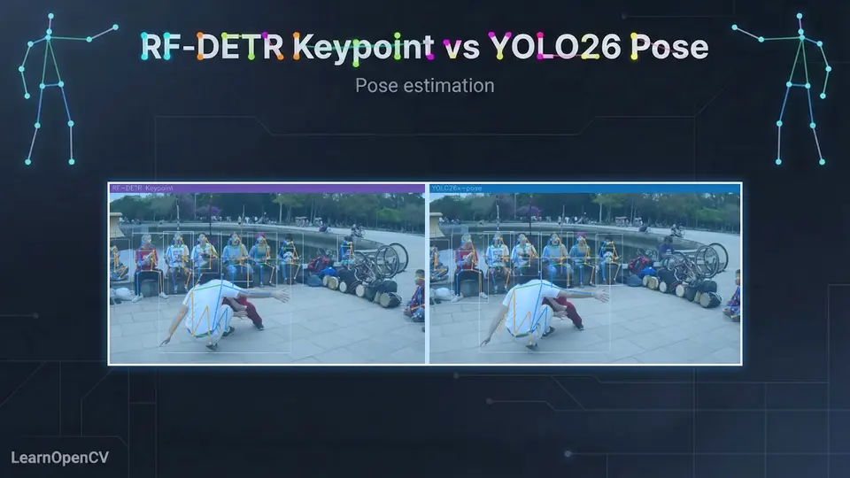

# RF-DETR Keypoint vs YOLO26 Pose: An Independent Test

**This folder contains the notebook and assets for the LearnOpenCV blog post [RF-DETR Keypoint vs YOLO26 Pose: An Independent Test](https://learnopencv.com/rf-detr-keypoint-vs-yolo26-pose/).**

RF-DETR Keypoint is Roboflow's new transformer pose model, and Roboflow reports it edges past Ultralytics' largest YOLO26 pose model on COCO. We put both models in front of the same photos and clips, drew their skeletons in the same style, hunted for the cases where each one fails, and fine-tuned both on a small tiger dataset. Everything runs in a free Colab notebook.

  

  
  &nbsp;
  

## Run it

Open `RF_DETR_Keypoint_vs_YOLO26_Pose.ipynb` in Google Colab with the badge above, pick a T4 GPU runtime, and run all cells. The notebook installs pinned versions of `rfdetr` and `ultralytics`, pulls the sample images and clips from this folder's `assets/` directory, and reproduces every figure in the post: the side-by-side comparisons, the failure gallery, the NMS switch, the video demos, and the Tiger-Pose fine-tune. No API key is needed, and it is friendly for a first read.

## What's inside

- `RF_DETR_Keypoint_vs_YOLO26_Pose.ipynb` — the full, runnable notebook.
- `assets/` — the sample images and short clips the notebook runs on, each credited in `assets/CREDITS.md`.

## References

- [Launch: RF-DETR Keypoint in Roboflow](https://blog.roboflow.com/launch-rf-detr-keypoint-in-roboflow/)
- [RF-DETR documentation](https://rfdetr.roboflow.com/latest/)
- [Ultralytics YOLO26 pose docs](https://docs.ultralytics.com/tasks/pose/)

## License

Code in this folder is released under the MIT License. RF-DETR code and weights are Apache 2.0. Ultralytics YOLO26 is under the AGPL-3.0 license (see the Ultralytics repository). Sample images and videos belong to their sources, listed in `assets/CREDITS.md`.

---

  

<h2 align="center">Build Production-Ready Computer Vision &amp; AI Solutions</h2>

  LearnOpenCV is maintained by <a href="https://bigvision.ai/"><strong>BigVision.AI</strong></a>, a computer vision and AI consulting company. We help organizations design, build, optimize, and deploy production-ready AI solutions. Our team has deep expertise in computer vision, deep learning, multimodal AI, and edge deployment, with experience solving complex technical challenges across industries.

  Have a project in mind? Talk with our expert AI solution builders.

  

