# Robust Image Alignment with ALIKED, LightGlue, and MAGSAC++

A photographed form can be easy to read and still be difficult to compare with its template. The page is tilted, one corner is farther from the camera, and handwritten fields introduce content that does not exist in the blank original. If we subtract the two images immediately, almost every printed line looks like a change.

Image alignment, also called image registration, gives those comparisons a common coordinate system. It also lets us locate a familiar book cover in a cluttered photograph, match two views of a wall, or prepare overlapping photographs for stitching. The interesting part is deciding which correspondences to trust and whether one transformation actually describes the scene.

We will build a Python pipeline that extracts features with **ALIKED**, matches them with **LightGlue**, and estimates a homography using **MAGSAC++**. Alongside the successful examples, we will inspect an absent target and a scene whose depth prevents a single homography from aligning everything.

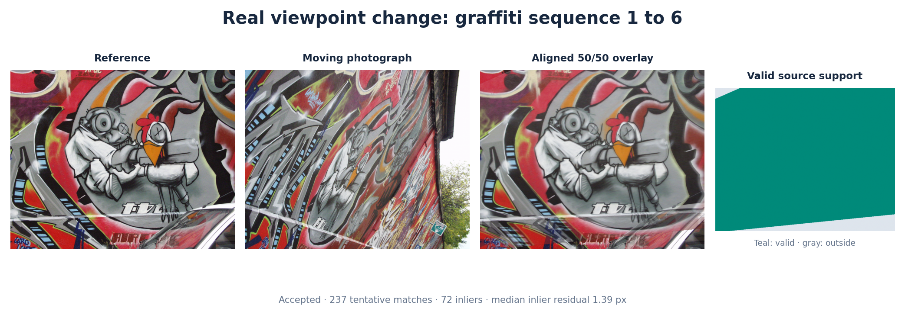

**OpenCV version:** every example and recorded experiment uses **OpenCV 5.1.0**, the latest stable OpenCV 5.x release rechecked on **November 19, 2026**. The Python experiments were run on November 14. The official release tag is pinned in the companion build script. ALIKED and LightGlue run through their PyTorch implementation; OpenCV handles geometric estimation, warping, masks, and the classical baseline. [OpenCV 5.1.0 release](https://github.com/opencv/opencv/releases/tag/5.1.0)

**Download the code and notebook:** The download includes the complete Jupyter notebook, standalone Python code, and a native C++ implementation of the same examples. Click the **Download Code** button and sign up for our newsletter, and we’ll email you everything in one ZIP file.

<!-- repository-reader-note -->
[Open this article on LearnOpenCV](https://learnopencv.com/robust-image-alignment/) to use its newsletter registration and **Download Code** button.
<!-- /repository-reader-note -->

## What You Will Learn

- Build an image alignment pipeline with ALIKED features, LightGlue matches, and MAGSAC++ geometric estimation.
- Check a homography before using it, preserve valid pixels when warping, and compare against SIFT and RANSAC.
- Align documents and locate a known object design from one reference image.
- Measure independent alignment error and understand failures caused by absent targets, repeated patterns, and parallax.

## Table of Contents

1. [Examples and what they tell us](#1-the-examples-and-what-each-one-tells-us)
2. [Choose a transformation](#2-choose-a-transformation-before-choosing-a-matcher)
3. [The complete alignment pipeline and setup](#3-the-complete-alignment-pipeline)
4. [Keep a classical baseline](#4-keep-a-classical-baseline)
5. [ALIKED feature extraction](#5-aliked-describes-selected-image-locations)
6. [LightGlue matching](#6-lightglue-matches-using-context)
7. [MAGSAC++ robust estimation](#7-magsac-estimates-a-transformation-despite-wrong-matches)
8. [Validation, warping, and ECC](#8-build-an-alignment-that-can-be-rejected)
9. [Identify an object from one reference](#9-identify-an-object-from-one-reference-image)
10. [Documents, inspection, and overlapping photographs](#10-align-documents-compare-surfaces-and-prepare-overlapping-photographs)
11. [Measurements and results](#11-measure-what-changed-in-the-pipeline)
12. [Failure cases](#12-understand-failures-before-deploying-the-method)
13. [Run your own images](#13-run-your-own-images-and-choose-a-configuration)
14. [Conclusion](#conclusion)
15. [Frequently asked questions](#frequently-asked-questions)
16. [References](#references)

## 1. The examples and what each one tells us

The examples deliberately cover different questions. The Oxford *graf* sequence changes viewpoint; *leuven* changes illumination. Their supplied homographies let us measure geometric error rather than judge the pictures only by eye. The photographed form tests template registration when some content has changed. The biscotti-package example tests locating a known printed design from a single reference. The aloe stereo pair exposes the limits of global alignment.

| Example | What changes | What we can evaluate |
| --- | --- | --- |
| Graffiti wall | Viewpoint and perspective | Error against supplied homographies |
| Leuven scene | Illumination | Error against supplied homographies |
| Photographed form | Perspective and filled fields | Qualitative alignment of unchanged printed structure |
| Biscotti package panel in a scene | Scale, viewpoint, clutter | Qualitative localization and rectification |
| Unrelated target-absent images | No matching target | Whether our acceptance checks reject the estimate |
| Aloe stereo pair | Viewpoint and depth-dependent displacement | Where one global homography leaves misalignment |

These are real captured images. The benchmark sequences come from the [Oxford affine-covariant regions dataset](https://www.robots.ox.ac.uk/~vgg/research/affine/); the companion manifest records their sources and checksums. The form comes from our earlier [feature-based image alignment tutorial](https://learnopencv.com/image-alignment-feature-based-using-opencv-c-python/). The box and aloe examples are OpenCV sample images.

The document and box examples do not come with independent ground-truth homographies. We use them to explain applications, not to manufacture precise accuracy numbers. Any synthetic transformations used by the tests are labelled separately from these captured examples.

## 2. Choose a transformation before choosing a matcher

An alignment method needs a model of how image coordinates can move. If the camera or surface only shifts in the image, a translation may be enough. A similarity transform adds rotation and uniform scale. An affine transform also permits shear and different scales along two axes. A homography describes a projective mapping and handles the perspective change of a plane.

A homography has the form

$$
\begin{bmatrix}u\\v\\w\end{bmatrix}
=H\begin{bmatrix}x\\y\\1\end{bmatrix},
\qquad
(x',y')=\left(\frac{u}{w},\frac{v}{w}\right).
$$

Multiplying every entry of `H` by the same nonzero value leaves the mapping unchanged. The matrix has eight independent degrees of freedom, so at least four point correspondences are needed, in a nondegenerate configuration. In practice, we want more points spread across the surface.

One homography is appropriate for a planar target, such as a flat document or book cover. It can also relate views of a general scene when the camera rotates about its projection center. If the camera translates through a scene with depth, foreground and background usually move differently. Better matches cannot remove that parallax. Our [homography examples](https://learnopencv.com/homography-examples-using-opencv-python-c/) develop these geometric cases with diagrams.

Throughout the code, the **reference** is the coordinate system we want to obtain. The **moving image** is the photograph we will warp into it. Every returned alignment matrix maps **moving coordinates to reference coordinates**. This convention will also make object localization straightforward: invert the matrix to move the reference boundary into the scene.

## 3. The complete alignment pipeline

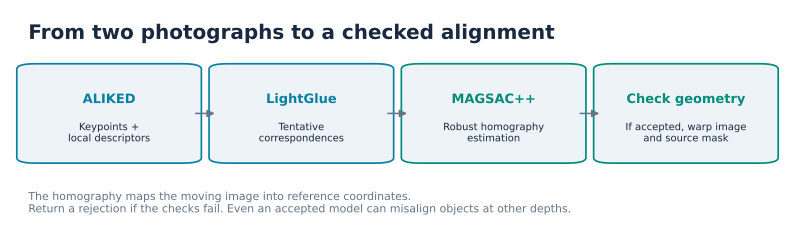

*ALIKED, LightGlue, and MAGSAC++ solve different parts of the problem. Validation applies explicit geometric safeguards before an application uses the estimate.*

ALIKED finds image locations that can be described locally. LightGlue looks for corresponding locations in the other image. MAGSAC++ estimates a transformation despite incorrect correspondences. We then inspect the transformation and its supporting points before producing an aligned image.

The interfaces matter as much as the model names. A keypoint is an `(x, y)` coordinate. A descriptor is a vector describing the local appearance around it. A match pairs a reference keypoint with a moving-image keypoint. A homography acts on coordinates; warping samples image pixels according to that mapping.

A high match score does not establish that the whole image is aligned. A valid matrix does not establish that the target is present. Each stage supplies evidence for the next, and the final decision must reflect what the application actually needs.

### Set up the released OpenCV environment

Extract the downloaded ZIP and open a terminal in its `Robust-Image-Alignment` folder. Create an isolated environment, install the pinned dependencies, and build OpenCV with the Python interpreter from that environment. All later commands assume this same project folder:

```bash
cd Robust-Image-Alignment
python3 -m venv .venv
source .venv/bin/activate
python -m pip install --upgrade pip
python -m pip install -r requirements.txt
python -m pip install --no-deps -r requirements-lightglue.txt
PYTHON_BIN="$VIRTUAL_ENV/bin/python" bash scripts/build_opencv.sh
python download_assets.py
python download_models.py
```

The neural dependency file pins LightGlue to the tested Git commit. We install it with `--no-deps` because its upstream requirements would otherwise pull in an older OpenCV wheel. The build script checks out the verified OpenCV 5.1.0 release commit and builds the modules needed here. Git, CMake, a C++ compiler, and Python development headers are required. On Linux, JPEG and PNG development packages are also needed for the sample-image codecs. The project README gives the tested platform-specific setup.

Check the imported runtime before running the examples:

```python
import cv2

print("OpenCV:", cv2.__version__)
print("Imported from:", cv2.__file__)
assert cv2.__version__ == "5.1.0"
assert hasattr(cv2, "USAC_MAGSAC")
```

As of the environment check for this tutorial, the available OpenCV 5 PyPI wheel was the older `5.0.0.93` distribution. Installing that wheel is not a way to reproduce an experiment labelled 5.1.0. Keep one active `cv2` installation in the environment and inspect its import path if the version assertion fails.

The asset downloader resolves paths from its own location, fetches immutable source URLs, and verifies SHA-256 checksums. It reuses files that already match the manifest. The model downloader verifies the exact pretrained checkpoints before they enter the model cache; subsequent runs reuse them.

## 4. Keep a classical baseline

It is useful to have a familiar pipeline before adding a learned matcher. Our baseline detects SIFT features, finds two nearest descriptor neighbors, and retains a match when the nearest is sufficiently more distinctive than the runner-up. SIFT descriptors use an L2 distance. Hamming distance is appropriate for binary descriptors such as ORB, not for this SIFT configuration.

The companion gives each method the same image-size cap and feature budget:

```python
from robust_image_alignment import FeatureMatcher

sift_baseline = FeatureMatcher(
    method="sift",
    max_keypoints=2048,
    resize=1024,
    ratio=0.8,
)
```

A ratio test asks whether a local descriptor has an ambiguous alternative. It does not check whether all retained matches agree on the same image transformation. The baseline still needs robust geometric estimation and the same acceptance checks as the learned pipeline.

Direct alignment provides another useful comparison. ECC adjusts a transformation to improve intensity agreement between images. It is especially interesting as a refinement after rough alignment; a large displacement can make initialization important. We introduced the method through historic color-channel registration in [Image Alignment using ECC](https://learnopencv.com/image-alignment-ecc-in-opencv-c-python/). Here we test it as an optional step rather than assuming it improves every pair.

## 5. ALIKED describes selected image locations

ALIKED is the feature extractor. Its Sparse Deformable Descriptor Head learns supporting sample positions around each detected keypoint, gathers feature values there, and combines them into a descriptor. The sample pattern can adapt to local image structure instead of remaining a fixed grid. [ALIKED paper](https://arxiv.org/abs/2304.03608)

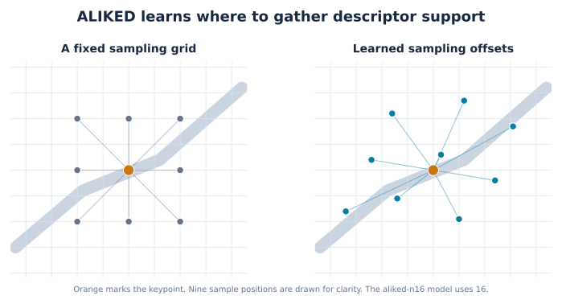

*Illustration of the descriptor-sampling idea. The positions shown are explanatory, not measured offsets from the example photographs.*

ALIKED still computes convolutional image feature maps. Its sparse descriptor head avoids constructing a separate descriptor at every pixel. For our examples, the wrapper uses the `aliked-n16` variant and its matching LightGlue checkpoint.

```python
matcher = FeatureMatcher(
    method="lightglue",
    device="auto",
    max_keypoints=2048,
    resize=1024,
)
```

`device="auto"` selects an available accelerator or CPU. We construct this object once and reuse it; repeatedly loading models would add work unrelated to matching a new image.

The module accepts OpenCV BGR arrays. Internally, it converts them into RGB tensors with channel-first layout and values in `[0, 1]`. Feature extraction can use a smaller image, but returned keypoints are mapped back to the original input coordinates. Applying another scale factor to those coordinates would move otherwise correct matches.

Increasing the feature budget can add useful coverage, but it also creates more matching work. It can add ambiguous points on repeated textures too. We therefore evaluate a fixed configuration first and change the budget as a measured trade-off.

## 6. LightGlue matches using context

Consider two similar windows on the same facade. Their local descriptors may look alike. LightGlue uses self-attention to refine descriptors through relationships within an image, and cross-attention to exchange information between the two feature sets. This provides context beyond an isolated descriptor comparison. [LightGlue paper](https://arxiv.org/abs/2306.13643)

The assignment head combines pairwise similarity with matchability: whether a detected point has a corresponding point in the other image. Final matches pass a mutual-consistency check and a score threshold.

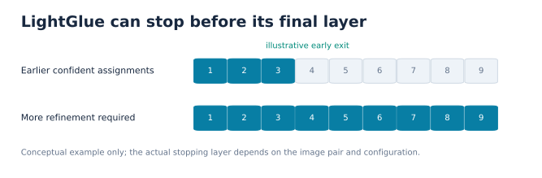

*Adaptive computation: an image pair can stop early when assignments are sufficiently confident. Confidently unmatchable points can be removed from subsequent layers.*

It is important to keep three ideas separate. Matchability concerns the existence of a counterpart. An assignment score concerns a proposed correspondence. The confidence used for adaptive depth concerns whether additional layers are expected to change the assignment. Uncertain points are not simply discarded for being uncertain.

The extractor and matcher are a specific pairing. An equally sized descriptor from another network is not automatically compatible with the pretrained weights. The [official implementation](https://github.com/cvg/LightGlue) supplies separate configurations for supported feature families; our environment pins its code commit as well as the model names.

Our [introduction to neural feature matching](https://learnopencv.com/feature-matching/) provides a broader view of this family of methods. For repeated queries, extract the reference once:

```python
from download_assets import download_assets
from robust_image_alignment import load_image

DATA_DIR = download_assets(verbose=False)
reference = load_image(DATA_DIR / "opencv/box.png")
scene = load_image(DATA_DIR / "opencv/box_in_scene.png")

reference_features = matcher.extract(reference)
scene_features = matcher.extract(scene)
matches = matcher.match(reference_features, scene_features)

print("Tentative matches:", len(matches.reference_points))
```

The returned arrays contain paired points in the original images. This is enough to ask the next question: do those points support one plausible transformation?

## 7. MAGSAC++ estimates a transformation despite wrong matches

Ordinary least-squares fitting can be pulled away by incorrect correspondences. RANSAC addresses this by repeatedly fitting candidate models from small subsets and evaluating their support. A match that agrees with a model within a chosen tolerance is an inlier for that model; it is not automatically a verified physical correspondence.

A tight inlier threshold can discard useful but noisy matches; a loose one can admit incorrect correspondences. MAGSAC accounts for uncertainty in the noise scale by marginalizing over a range of scales rather than relying only on a hard inlier count. MAGSAC++ develops a revised scoring function and an efficient iteratively reweighted fitting procedure. The paper also introduces Progressive-NAPSAC sampling. [MAGSAC paper](https://arxiv.org/abs/1803.07469), [MAGSAC++ paper](https://arxiv.org/abs/1912.05909)

OpenCV exposes MAGSAC++ through the USAC framework. The homography call at the heart of our implementation is:

```python
H, inlier_mask = cv2.findHomography(
    matches.moving_points,       # Source coordinates.
    matches.reference_points,    # Destination coordinates.
    method=cv2.USAC_MAGSAC,
    ransacReprojThreshold=3.0,    # Original reference-image pixels.
    maxIters=10000,
    confidence=0.999,
)
```

The order of the point arrays fixes the matrix direction. Here `H` maps the moving image into the reference. Passing the arrays in the opposite order estimates the opposite mapping.

The OpenCV preset uses MAGSAC scoring and sigma-consensus local optimization with uniform sampling. It does not enable every component described in the paper. The reprojection threshold remains meaningful for the implementation, including its inlier and termination behavior; the call is not parameter-free. [OpenCV 5.1.0 USAC configuration](https://github.com/opencv/opencv/blob/5.1.0/modules/geometry/src/usac/ransac_solvers.cpp#L1176-L1183)

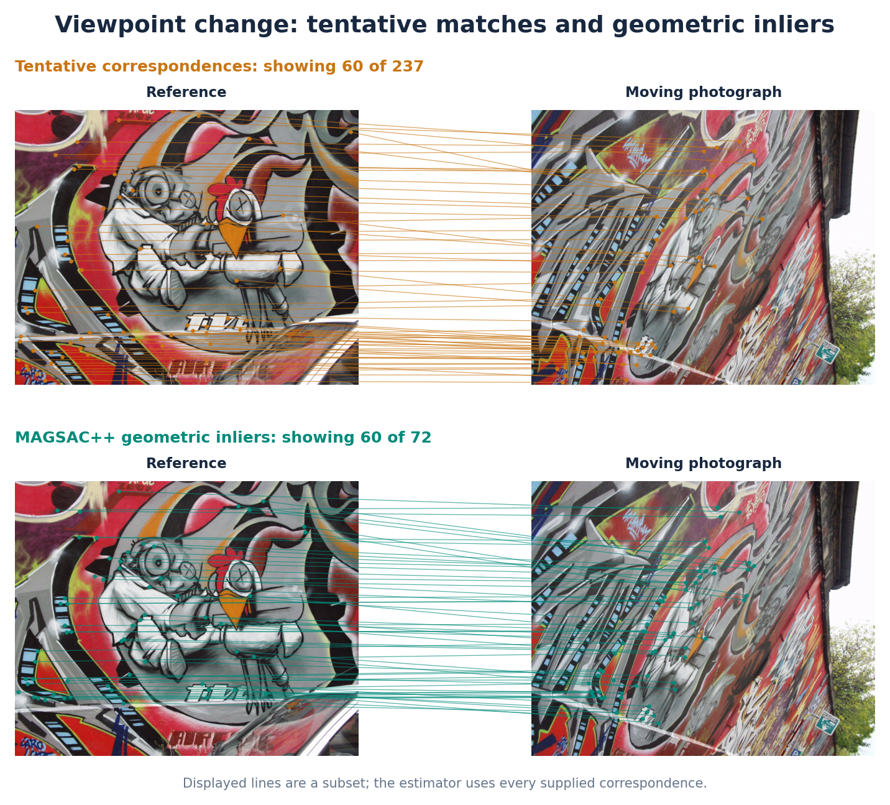

*Geometric estimation tests whether correspondences support the selected transformation. A match count alone does not answer that question.*

To compare RANSAC with MAGSAC++, hold the correspondences fixed and change the estimator. If we also change the matcher, we cannot tell which change caused an improvement or failure.

## 8. Build an alignment that can be rejected

The reusable function wraps estimation with explicit checks. It tests the number and ratio of returned inliers, their reference-image coverage, their residuals, and the projected boundary. It also rejects nonfinite matrices and selected degenerate configurations.

```python
from robust_image_alignment import (
    AlignmentConfig,
    estimate_alignment,
    warp_alignment,
)

config = AlignmentConfig(
    reprojection_threshold=3.0,
    min_inliers=12,
    min_inlier_ratio=0.25,
    min_reference_coverage=0.04,
    max_median_reprojection_error=3.0,
)

result = estimate_alignment(
    matches,
    reference.shape,
    scene.shape,
    config=config,
    estimator="magsac",
)

if result.accepted:
    aligned, valid_mask = warp_alignment(
        scene, result, reference.shape
    )
    cv2.imwrite("aligned.png", aligned)
    cv2.imwrite("valid_mask.png", valid_mask)
else:
    print("Rejected:", "; ".join(result.reasons))
```

These are explicit, adjustable safeguards. They are not universal thresholds or a calibrated probability of target identity. A stricter deployment may need rejection rules trained and evaluated against a much larger collection of similar-looking negative images.

Coverage is especially useful. Twelve correspondences on a tiny repeated word do not support the full page as convincingly as points distributed across its structure. We measure the convex hull of reference inliers relative to the reference area. We record scene coverage too, but do not require a known object to occupy a large fraction of a cluttered scene.

### Warp the mask as well as the image

The homography can map some output pixels outside the source photograph. Those pixels have no source evidence. We warp a white source mask with nearest-neighbor interpolation to mark supported output locations. Testing `aligned != 0` would be wrong because a real document can contain black pixels.

For a readable overlay, preserve the reference where source pixels are unavailable:

```python
if result.accepted:
    overlay = cv2.addWeighted(reference, 0.5, aligned, 0.5, 0)
    overlay[valid_mask == 0] = reference[valid_mask == 0]
    cv2.imwrite("overlay.png", overlay)
```

For quantitative intensity comparisons, also consider interpolation support near boundaries and exclude pixels whose content genuinely changed. An unfilled template and a completed form are not expected to have identical intensities after perfect registration.

### Optional ECC refinement

Our `refine_ecc()` function accepts the same moving-to-reference matrix convention as the rest of the module. Internally it inverts the matrix because OpenCV ECC uses the opposite warp direction, and it restricts optimization to estimated overlap.

```python
from robust_image_alignment import refine_ecc

if result.accepted:
    try:
        H_refined, correlation = refine_ecc(
            reference, scene, result.H
        )
        print("ECC correlation:", correlation)
    except (cv2.error, ValueError) as error:
        print("Keeping the feature estimate:", error)
```

The returned matrix is a candidate refinement. Retain the initial estimate if optimization fails, and evaluate whether refinement improves geometric error where ground truth is available. A higher correlation is useful evidence about intensity agreement, not proof that the correct plane or object was selected. The [OpenCV ECC API contract](https://github.com/opencv/opencv/blob/5.1.0/modules/video/include/opencv2/video/tracking.hpp#L319-L385) explains initialization and inverse warping.

## 9. Identify an object from one reference image

A matching pipeline can recognize a known visual appearance without training a new model for that target. Start with a tightly cropped reference showing the surface you want to find. Extract its features once, match each new scene against them, and accept a result only when the geometric evidence passes the configured checks.

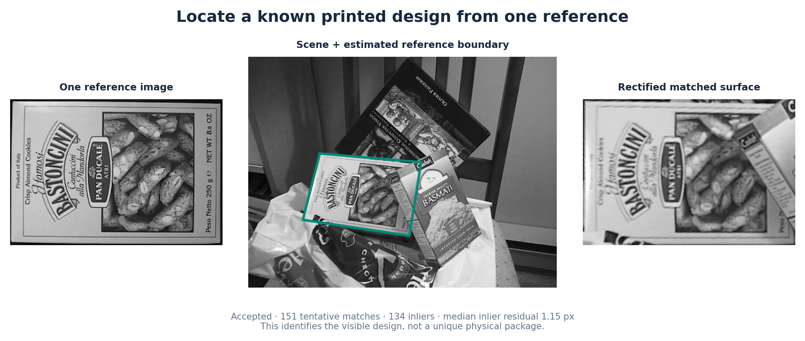

*The reference supplies the known appearance. Its projected boundary locates that appearance in the new photograph. This sample is a qualitative localization demonstration.*

For a planar target, the inverse homography maps reference corners into the scene. The companion already computes that quadrilateral:

```python
if result.accepted:
    identified_scene = scene.copy()
    polygon = result.projected_reference_quad.round().astype("int32")
    cv2.polylines(
        identified_scene,
        [polygon],
        isClosed=True,
        color=(40, 220, 40),
        thickness=3,
        lineType=cv2.LINE_AA,
    )
    cv2.imwrite("identified_scene.png", identified_scene)
```

This is a useful route for posters, flat package labels, artwork, and book covers with distinctive visible detail. It identifies the reference appearance: two physical copies of the same cover can both match. It does not establish authenticity or teach a model the category “book” from one example. OpenCV's [feature matching and homography tutorial](https://github.com/opencv/opencv/blob/5.1.0/doc/py_tutorials/py_features/py_feature_homography/py_feature_homography.markdown) demonstrates the same geometric idea with classical correspondences.

The reference crop matters. If most features belong to the table behind an object, the system may match the table. Likewise, a single front view supplies little information about an unseen backside. Add reference views when the object has several relevant surfaces, and evaluate them as a catalogue of known appearances.

For a small catalogue, cache one feature set per reference and verify candidates against each query. As the catalogue grows, first retrieve a shortlist using an appropriate image-search representation, then use local matching and geometry for verification. Report “no reliable identification” when no candidate has sufficient evidence. Picking the highest score among poor candidates forces a wrong answer.

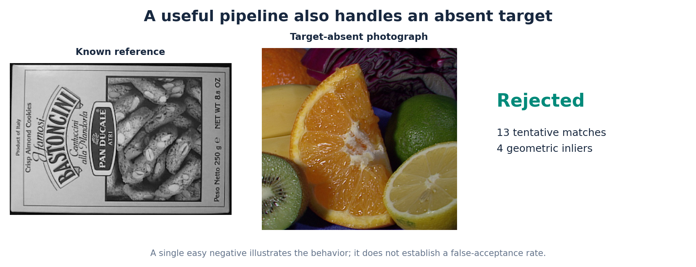

*Absence examples are part of identification testing. A few rejected negatives illustrate behavior; they do not establish a production false-acceptance rate.*

## 10. Align documents, compare surfaces, and prepare overlapping photographs

### Document template registration

Replace the box inputs with the photographed form and its template:

```python
form_template = load_image(DATA_DIR / "learnopencv/form.jpg")
form_photo = load_image(DATA_DIR / "learnopencv/scanned-form.jpg")
form_matches = matcher.match_images(form_template, form_photo)
form_result = estimate_alignment(
    form_matches, form_template.shape, form_photo.shape,
    config=config, estimator="magsac",
)

if form_result.accepted:
    registered_form, form_mask = warp_alignment(
        form_photo, form_result, form_template.shape
    )
    cv2.imwrite("registered_form.png", registered_form)
```

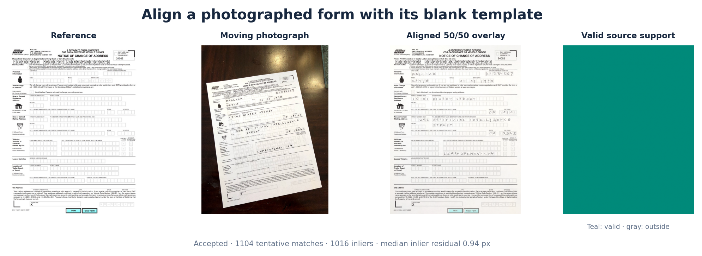

*Registration brings the printed structure into template coordinates. Filled fields remain real content differences.*

Once registered, a field can be read from a template-coordinate crop. The downstream OCR still needs its own accuracy checks. This is different from detecting a sheet's four outer corners and producing a front-facing scan, which we cover in [Automatic Document Scanner using OpenCV](https://learnopencv.com/automatic-document-scanner-using-opencv/).

### Surface comparison and inspection

The same approach can align a printed label before checking its text or layout. Compare within the valid overlap and, if appropriate, within application-defined regions. Exposure, shadows, reflections, interpolation, and actual material deformation can all affect a difference image. Establish those tolerances using unchanged examples before treating residual pixels as defects.

### Overlapping photographs

For suitable views, the aligned output provides a starting point for stitching. A finished panorama also needs an output canvas, exposure handling, seam selection, and blending. Our reference-sized warp is deliberately a registration output, not a complete panorama implementation.

The graffiti-wall example at the start of the article offers a real perspective change with supplied geometry for evaluation.

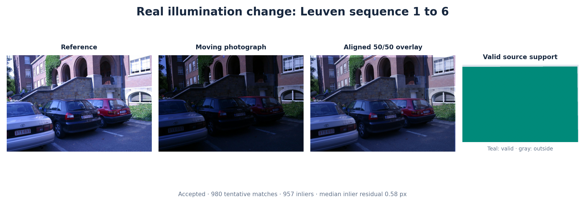

*Geometry can be evaluated despite appearance differences. Intensity subtraction alone would mix lighting change with alignment error.*

## 11. Measure what changed in the pipeline

The central question is whether the estimated geometry is useful. More matches can help, but can also add repeated structures and outliers. More returned inliers can reflect a looser threshold. Faster matching can be irrelevant if feature extraction dominates the application.

We separate the comparisons:

| Comparison | What stays fixed | What changes |
| --- | --- | --- |
| Classical versus learned pipeline | Image pairs, size cap, evaluation protocol | Extractor and matcher |
| ALIKED nearest-neighbor versus LightGlue | Extracted ALIKED features | Correspondence selection |
| RANSAC versus MAGSAC++ | Correspondences and evaluation geometry | Robust-estimator configuration |
| Before versus after ECC | Initial feature-based homography | Direct refinement |

For geometric error, sample a fixed grid in the reference image. Use the supplied ground-truth homography to place those points in the moving image and retain the points inside both frames. Apply the estimated moving-to-reference homography to bring them back, then measure their distances from the original reference positions. This reports error in original reference-image pixels and avoids evaluating only on the estimator’s own selected inliers.

The *graf* and *leuven* sequences provide a compact reproducible comparison. They do not represent every document, package, camera, or industrial surface. Keep their results separate from the application demonstrations without independent ground truth.

### Eight held-out pairs from two capture sequences

We reserved image 1→2 from each sequence for checking the setup and evaluated image 1→3 through 1→6: eight pairs from **two scenes**, with four viewpoint changes and four illumination changes. We requested at most 2,048 features per image and capped the longest side at 1,024 pixels without upsampling. A pair passes our teaching criterion when the estimate passes the configured safeguards and its median overlap-grid error is below three original reference-image pixels. The repeated runs measure timing; they do not turn eight image pairs into 40 independent examples.

With MAGSAC++ after each matching route, the results were:

| Correspondence pipeline | Evaluation pairs passing the criterion | Which viewpoint cases failed |
| --- | --- | --- |
| SIFT + ratio matching | 6 / 8 | graf 1→5 and 1→6 |
| ALIKED + ratio matching | 6 / 8 | graf 1→4 and 1→6 |
| ALIKED + LightGlue | 8 / 8 | None in this set |

The useful difference is visible in the difficult graffiti pairs. On graf 1→6, ALIKED with ratio matching supplied too little useful support to estimate a homography. LightGlue used the same extracted features and produced an accepted alignment with **1.76-pixel median independent grid error**. SIFT's estimate for that pair was rejected. On the illumination sequence, all three pipelines passed all four evaluation pairs; learned matching was not necessary for every example.

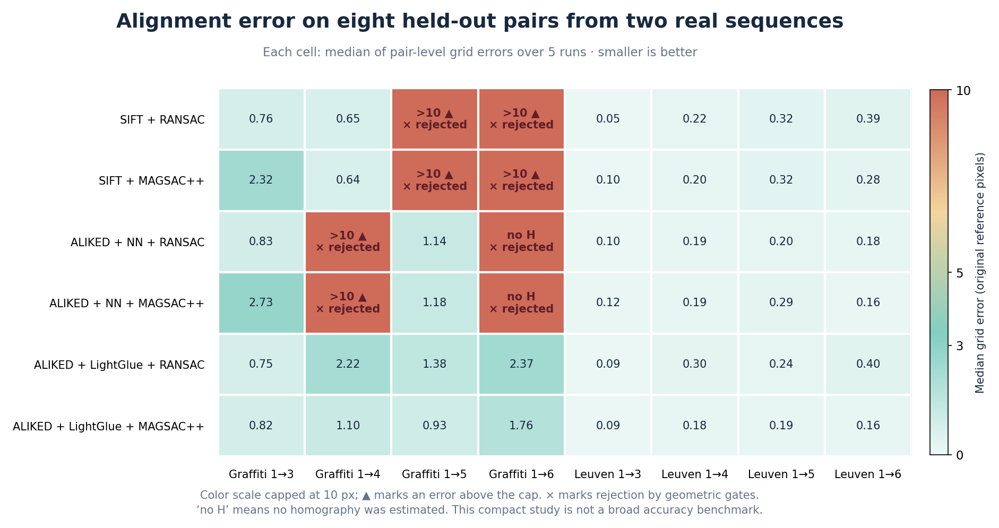

*Each cell uses the median of five repeated runs on the same pair. Rejections and missing homographies remain visible. Values above 10 pixels are capped only in the color scale and marked explicitly. The full uncapped results are retained in the companion JSON.*

RANSAC also gave LightGlue 8/8 passes in this small set. MAGSAC++ reduced LightGlue's graf 1→6 median error from 2.37 to 1.76 pixels, but it did not improve every correspondence set: with SIFT on graf 1→3, RANSAC gave 0.76 pixels and MAGSAC++ gave 2.32. The appropriate conclusion is that matching and estimator choice both matter. These two scenes do not establish a universally best configuration.

### What the processing time includes

The recorded system was **Ubuntu 24.04 on an Intel Core i7-6850K with one NVIDIA GTX 1080 Ti**, using Python 3.14.3, OpenCV 5.1.0, NumPy 2.4.2, PyTorch 2.10.0+cu126, torchvision 0.25.0+cu126, and Kornia 0.8.2. OpenCV used one CPU thread and PyTorch used four CPU threads. Neural extraction and LightGlue ran on the GPU; SIFT and the nearest-neighbor matcher ran on the CPU.

For a comparable timing workload, the table below uses the **same five pairs that all three MAGSAC++ pipelines successfully aligned**, with five measured repetitions per pair after warm-up. Each time includes extraction for both images, matching, geometric estimation and acceptance checks, and image/mask warping. It excludes file I/O, model loading, plotting, and ECC. The figures are steady-state measurements on this machine; the percentile range spans those 25 trials, rather than a statistical confidence interval.

| Pipeline with MAGSAC++ | Median processing time | 10th–90th percentile |
| --- | --- | --- |
| SIFT + ratio matching | 403 ms | 370–430 ms |
| ALIKED + ratio matching | 116 ms | 106–124 ms |
| ALIKED + LightGlue | 265 ms | 227–390 ms |

ALIKED with ratio matching was the quickest route here, while LightGlue recovered the extra difficult viewpoint pairs. LightGlue's name is not a promise of real-time performance for a particular feature budget or GPU. A reference cached in advance removes its extraction cost, but that is a different workload from the two-image alignment measured above.

### A controlled experiment for MAGSAC++

To study estimator behavior separately, we generated 160 point correspondences with a known projective transformation, replaced 60% with uniform outliers, and added Gaussian noise to the remaining moving-image coordinates. Both estimators received exactly the same points for each of 12 data seeds. This is a **synthetic correspondence experiment**, not another set of photographed scenes.

At 1.5-pixel noise and a 3-pixel threshold, the median independent grid error across those seeds was **1.02 pixels for RANSAC and 0.53 pixels for MAGSAC++**. Both passed the acceptance checks in all 12 trials. The result supports the mechanism we wanted to demonstrate: accounting for noise-scale uncertainty can improve an estimate even when matching is held fixed.

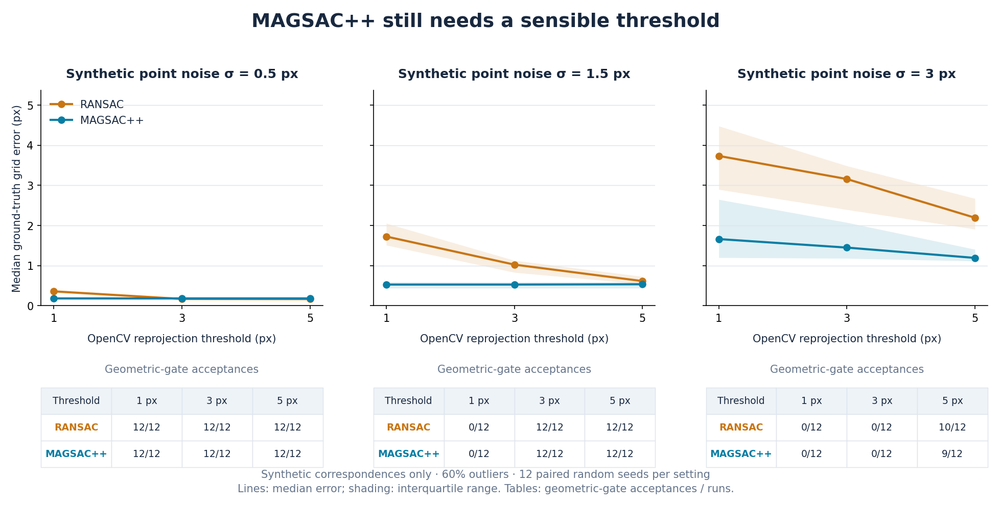

*Lines show median geometric error with an interquartile band. Acceptance counts are shown separately. The experiment uses uniform outliers; real repeated structures can create much more coherent false matches.*

The threshold still changes the usable result. At that same 1.5-pixel noise level, the 1-pixel threshold caused **both pipelines to fail our acceptance gates in all 12 trials**, even though MAGSAC++ still fitted relatively accurate models. A good fit and enough threshold-defined support are different requirements. This is why the OpenCV call should not be described as parameter-free.

### ECC can improve one error statistic while worsening another

On graf 1→6, ECC refinement reduced median grid error from **1.76 to 0.54 pixels**, while the 95th-percentile error increased from **2.23 to 2.51 pixels**. On leuven 1→6, median error changed from **0.159 to 0.189 pixels**, and its 95th percentile changed from **0.400 to 0.478 pixels**. Refinement is therefore an optional candidate whose effect should be measured with the error statistic the application needs.

The downloaded package includes a raw experiment file recording every pair, configuration, repeat, acceptance decision, transformation, stage time, and independent error. It also retains the controlled-study data and ECC outcomes.

Timing must include its boundaries. Our reports distinguish feature extraction, feature matching, and robust estimation. Model construction and first-time weight downloads are outside steady-state timing. Accelerators must be synchronized, and repeated measurements should follow warm-up runs.

A pair-alignment measurement includes feature extraction for both images. A cached-reference identification measurement includes only extraction for the new scene, followed by matching and verification. Those are different workloads and should be named accordingly. LightGlue's [official benchmark](https://github.com/cvg/LightGlue/blob/5a650c444718caffc2669dc0094cde908f42dd73/benchmark.py) extracts features before timing the matcher, so its matcher FPS cannot be substituted for complete alignment throughput.

## 12. Understand failures before deploying the method

The most informative failure is sometimes a plausible result. If many matches support the background, the estimated transform may align that background while misplacing the object you care about. If a target contains repeated panels, a shifted panel can support consistent but incorrect geometry.

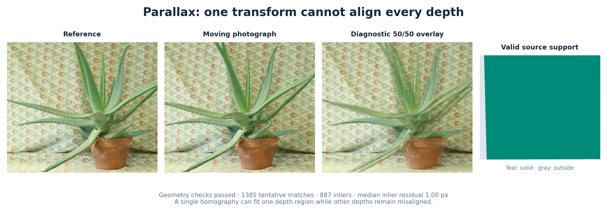

*This pair passes our acceptance checks with 887 inliers and a median inlier residual of 1.00 pixels. The doubled structures still reveal depth-dependent misalignment: one homography can fit a selected surface while leaving other depths displaced.*

The estimator's acceptance and the application's success are therefore separate questions. Inspect where inliers lie, whether the projected target boundary is plausible, and whether independent landmarks align. A dense crop of inliers in one corner leaves the opposite side weakly constrained.

Blur can remove detail. Low-texture surfaces can provide too few repeatable features. Occlusion reduces the available support. A small target may occupy only a few dozen pixels even in a large photograph. Strong distortion, curved pages, flexible packaging, or independently moving objects can violate the selected model.

When the target is absent, our function may return too few matches or geometry that fails its gates. It may also find a misleading pattern that survives them. Evaluate difficult negatives from the actual application, including neighboring product variants and repeated designs. Tune an operating point on validation data and report performance on separate examples.

Choose the response to failure according to its cause. Better lighting or higher target resolution can recover lost detail. More reference views can cover unseen surfaces. A different geometric model, local deformation field, depth information, or a dense matcher may be appropriate when one plane is inadequate. Repeatedly lowering thresholds until a matrix appears hides the problem.

## 13. Run your own images and choose a configuration

The command-line entry point writes diagnostics without opening a window:

```bash
python robust_image_alignment.py \
  --reference assets/downloads/opencv/box.png \
  --moving assets/downloads/opencv/box_in_scene.png \
  --method lightglue \
  --estimator magsac \
  --output-dir output/box \
  --no-display \
  --validate
```

Use `--method sift` for the classical baseline, or `--method aliked-nn` to retain ALIKED and replace learned matching with ratio-tested nearest neighbors. `--estimator ransac` switches the robust configuration. The report records keypoint counts, matches, inliers, coverage, residuals, timing, and rejection reasons. `--validate` exits unsuccessfully when the acceptance checks reject the alignment, which is useful for automated experiments.

Start with a modest image-size cap and feature budget. Increase them when missing detail or poor spatial coverage explains failures, and measure the latency cost. Cache references that remain unchanged. Keep the extractor and matcher on the same device, and treat mixed precision, compilation, and alternative deployment backends as changes that need output and timing checks of their own.

## Conclusion

The practical choice depends on the images. A classical pipeline can remain an effective, simpler option. ALIKED plus LightGlue adds learned local features and contextual matching. MAGSAC++ supplies robust geometric estimation after either suitable correspondence route. Their individual costs and benefits should be visible in the measurements.

## Frequently asked questions

**Can I use the pipeline without a GPU?**

Yes. Select `device="cpu"` or `--device cpu`. Expect latency to depend on image resolution, feature budget, hardware, and the chosen matching path. Use the reported complete-pipeline measurements for the tested configuration.

**Does one reference mean I need no training at all?**

The extractor and matcher are already pretrained. You do not train a new target-specific model to enroll the reference in this example. The method recognizes a known appearance with geometric support; it does not learn an entire semantic class from that image.

**Why do good-looking matches sometimes produce a bad warp?**

The points may cluster in a small region, describe repeated patterns, belong to another plane, or use the wrong coordinate convention. The matrix may also be applied in the wrong direction. Check those causes before changing a model.

**Can MAGSAC++ repair bad LightGlue matches?**

It can estimate a model despite some incorrect correspondences when sufficient useful support exists. It cannot invent missing observations or guarantee that a consistent repeated pattern represents the intended target.

**Should I always refine with ECC?**

Treat refinement as an experiment. It needs a reasonable initialization and suitable shared image content, and it can fail or worsen the geometric estimate. Retain the original result unless the application has evidence for accepting the refinement.

**Can this align arbitrary medical scans or deformable images?**

The worked pipeline estimates a global 2D homography. Volumetric, cross-modality, and nonrigid registration introduce different models and objectives. Their shared name does not make them the same implementation problem.

**What should I keep when reproducing a result?**

Keep the environment manifest, model and asset identifiers, input dimensions, resize policy, feature budget, estimator settings, acceptance report, and timing protocol. The companion retains the transformations, diagnostics, independent errors, and timing trials alongside the figures. The notebook also exposes the matched point arrays for inspecting individual correspondences.

## References

- [ALIKED: A Lighter Keypoint and Descriptor Extraction Network via Deformable Transformation](https://arxiv.org/abs/2304.03608).
- [LightGlue: Local Feature Matching at Light Speed](https://arxiv.org/abs/2306.13643) and the [official implementation](https://github.com/cvg/LightGlue).
- [MAGSAC: Marginalizing Sample Consensus](https://arxiv.org/abs/1803.07469) and [MAGSAC++, a Fast, Reliable and Accurate Robust Estimator](https://arxiv.org/abs/1912.05909).
- [OpenCV 5.1.0 release](https://github.com/opencv/opencv/releases/tag/5.1.0), [USAC configuration](https://github.com/opencv/opencv/blob/5.1.0/modules/geometry/src/usac/ransac_solvers.cpp#L1176-L1183), and [ECC API contract](https://github.com/opencv/opencv/blob/5.1.0/modules/video/include/opencv2/video/tracking.hpp#L319-L385).
- [Oxford affine-covariant regions dataset](https://www.robots.ox.ac.uk/~vgg/research/affine/), which supplies the real viewpoint and illumination sequences used in the measured comparison.
