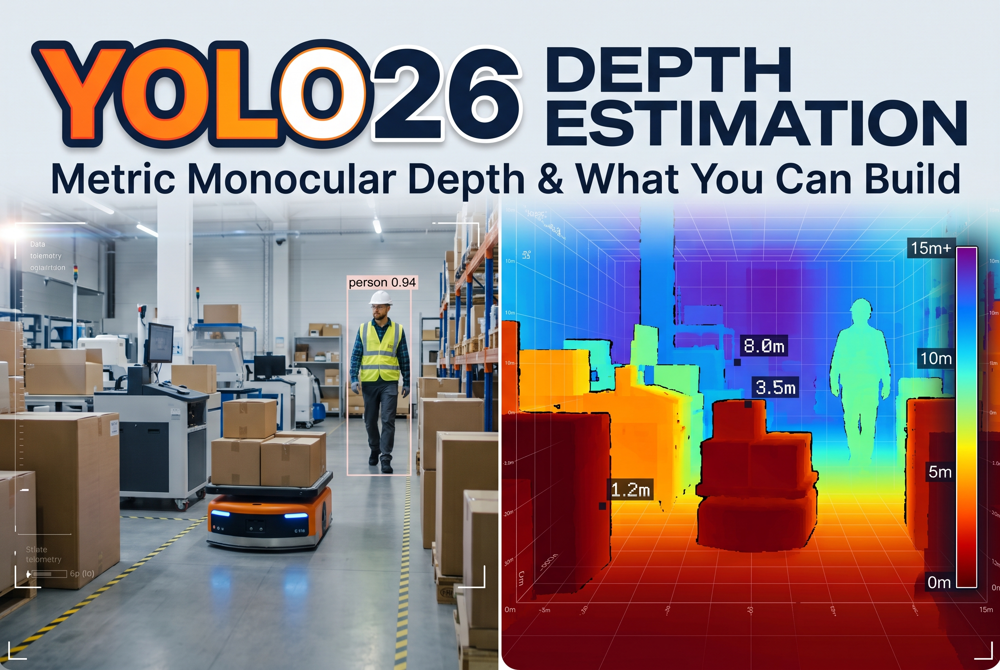

# YOLO26 Depth Estimation: Metric Monocular Depth and What You Can Build With It

<p align="center">
  
</p>

A hands-on capability tour of the new native depth task in Ultralytics YOLO26. One Colab notebook, one small checkpoint (`yolo26n-depth.pt`, 12.4 MB), and a dense map where every pixel is a real distance in meters. The notebook runs end to end on a free Colab T4 in a few minutes, with no setup beyond `pip install ultralytics`.

<p>
  <a href="https://colab.research.google.com/github/oliverhale07-dot/learnopencv/blob/master/Yolo26-depth-estimation/YOLO26_Depth_Capability_Tour.ipynb">
    
  </a>
  &nbsp;
  <a href="https://learnopencv.com/yolo26-depth-estimation-metric-monocular-depth-and-what-you-can-build-with-it/">
    
  </a>
</p>

## What you will learn

- What Ultralytics actually shipped: five depth checkpoints, a DPT-style dense head, and why the log-scale output matters for long range
- How to run depth prediction in three lines of Python and from the CLI, and how to read `results[0].depth.data` (an `(H, W)` tensor in meters)
- How to turn the raw map into a colorized figure without losing the metric scale
- Eight things you can build from a single depth map:
  1. Single-image depth with a meter colorbar
  2. A gallery across indoor and outdoor scenes
  3. Per-object distance labels (detection boxes + median depth inside each box)
  4. Near, mid and far free-space zones
  5. Depth-driven background blur (portrait mode from one lens)
  6. A single-image 3D point cloud
  7. Person-to-person spacing in 3D
  8. Depth on video, frame by frame (three clips, shown side by side as looping GIFs)
- How to fine-tune on your own data, validate with `delta1 / abs_rel / rmse / silog`, and export to ONNX

## Repository layout

```
Yolo26-depth-estimation/
├── YOLO26_Depth_Capability_Tour.ipynb   the notebook (outputs cleared; run it in Colab to regenerate every figure)
├── assets/                              every image and video the notebook uses
│   ├── bus.jpg, zidane.jpg
│   ├── gallery_scene1.jpg ... gallery_scene4.jpg
│   ├── bokeh_car.jpg, bokeh_pelican.jpg
│   └── people.mp4, aisle.mp4, car.mp4
├── yolo26-depth-estimation_featured.jpg the article's featured image
└── readme.md
```

The first code cells fetch `assets/` from this repository into a local folder next to the notebook (skipped if the files are already there, for example after a clone), and every later cell reads from that folder with relative paths. Nothing depends on Colab: the same notebook runs on a local machine with a GPU.

## Quick start

Open the notebook in Colab with the badge above, set the runtime to **T4 GPU**, and run all cells. Or run it locally:

```bash
pip install "ultralytics==8.4.174"
```

```python
from ultralytics import YOLO

model = YOLO("yolo26n-depth.pt")            # downloads on first use
results = model("assets/bus.jpg")
depth = results[0].depth.data.cpu().numpy()  # (H, W) float array, meters per pixel
print(depth.shape, depth[240, 320], "meters")
```

From the command line:

```bash
yolo depth predict model=yolo26n-depth.pt source=assets/bus.jpg
```

The Ultralytics release is pinned to the one every figure and number in the article was produced with, so the results reproduce. Newer releases can change inference details such as the input letterboxing, which shifts the metric values slightly.

## Numbers you should expect

Measured in this notebook on a free Colab T4 with `ultralytics 8.4.174`:

| Item | Value |
|---|---|
| `yolo26n-depth.pt` single image, PyTorch, T4 | about 32 ms |
| Same, CPU | about 1.1 s |
| Video (640x360), per-frame depth, T4 | about 30 FPS |
| Fine-tune, 15 epochs on the built-in `depth8` sample set | about 14 s, validation delta1 about 0.90 |
| ONNX export of the fine-tuned model | `best.onnx`, 19.8 MB |

Official NYU Depth V2 numbers for the five checkpoints (delta1, higher is better): n 0.882, s 0.896, m 0.921, l 0.930, x 0.933. See the [Ultralytics depth task docs](https://docs.ultralytics.com/tasks/depth/) for the full table.

## Things to know before you build on it

- The map is **metric**: a value of 4.2 means 4.2 meters. Normalize a copy for display, but keep the raw array for any measurement.
- The thresholds in the demos (4 m and 8 m for the zones, 2 m for spacing) are choices, not model constants. Set them for your task.
- Monocular depth is an inference, not a measurement. Glass, polished metal, sky and blank walls are unreliable, and error grows with distance. Fine-tune when your scenes differ from the pretraining domain.
- Fine-tuning tip: start from the pretrained checkpoint with `optimizer="AdamW"` and a low learning rate (`lr0=1e-4`); the defaults are tuned for training from scratch.

## References

- Ultralytics announcement: [YOLO26 now supports monocular depth estimation](https://www.ultralytics.com/blog/ultralytics-yolo26-now-supports-monocular-depth-estimation)
- Ultralytics docs: [Depth estimation task](https://docs.ultralytics.com/tasks/depth/)
- Sample media: `bus.jpg` and `zidane.jpg` from the Ultralytics assets, scene photos from [Lorem Picsum](https://picsum.photos/), video clips from the [Intel IoT DevKit sample videos](https://github.com/intel-iot-devkit/sample-videos)

## License

Code in this repository is released under the MIT License. Ultralytics YOLO26 weights and package are under the AGPL-3.0 license (see the Ultralytics repository). Sample images and videos belong to their respective sources listed above.

---

<p align="center">
  <a href="https://bigvision.ai/">
    
  </a>
</p>

<h2 align="center">Build Production-Ready Computer Vision &amp; AI Solutions</h2>

<p align="center">
  LearnOpenCV is maintained by <a href="https://bigvision.ai/"><strong>BigVision.AI</strong></a>, a computer vision and AI consulting company. We help organizations design, build, optimize, and deploy production-ready AI solutions. Our team has deep expertise in computer vision, deep learning, multimodal AI, and edge deployment, with experience solving complex technical challenges across industries.
</p>

<p align="center">
  Have a project in mind? Talk with our expert AI solution builders.
</p>

<p align="center">
  <a href="https://bigvision.ai/expert-ai-solution-builders?utm_source=locv-github">
    
  </a>
</p>
