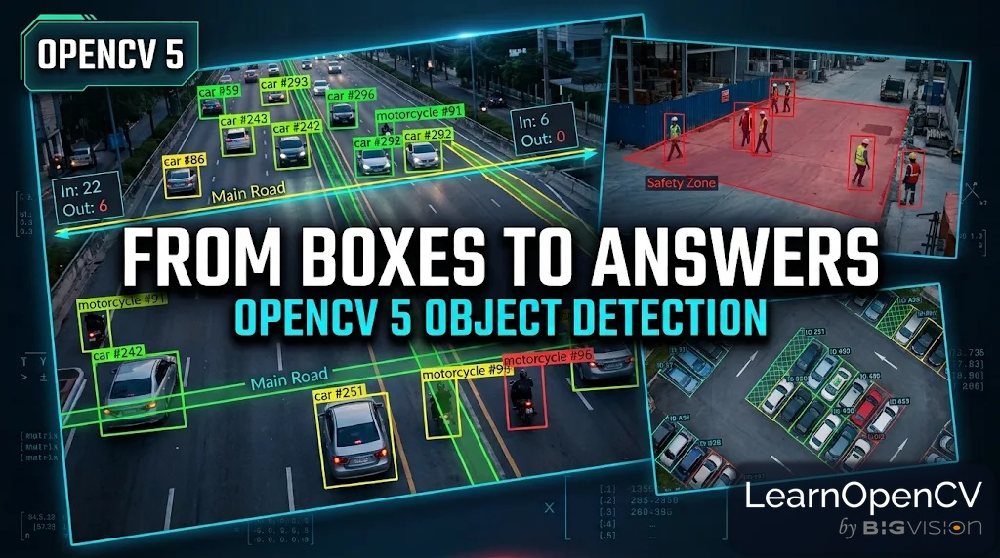

# OpenCV 5 Object Detection Use Cases: Traffic Counting, Parking Monitoring and Safety Zones

**This repository contains the code for the LearnOpenCV blog post [OpenCV 5 Object Detection Use Cases: Traffic Counting, Parking Monitoring and Safety Zones](https://learnopencv.com/opencv-5-object-detection-use-cases/).**

[](https://learnopencv.com/opencv-5-object-detection-use-cases/)

Three applications built on YOLO26 and the OpenCV 5 DNN engine, CPU only: traffic counting by line, lane and direction;
parking monitoring that tells parked cars from moving ones on a drifting camera; and safety-zone alerts with dwell
times, snapshots and event logs. Seven video examples and eight still-photo examples, all on free-license footage.

Everything at runtime is OpenCV 5 + NumPy. Ultralytics is used once, to export the ONNX model.

## Quick start

```bash
pip install -r requirements.txt
python code/export_models.py        # yolo26n_640.onnx and yolo26n_960.onnx -> models/
python code/get_media.py            # 10 clips and 8 photos -> assets/ (about 70 MB, from this repository)
python code/examples.py all         # the 7 video examples -> outputs/ (about 20 minutes on a laptop CPU)
python code/still_images.py         # the 8 photo examples -> outputs/
```

Run one example with `python code/examples.py traffic_highway`, or a quick 8-second pass over everything with
`python code/examples.py all 8`. Results are annotated videos (`outputs/0N_*.mp4`), CSV event logs, alert snapshots
and an occupancy chart.

The notebook `OpenCV5_Detection_Use_Cases.ipynb` runs the same code end to end on Google Colab. A free CPU or
T4 runtime is enough; the OpenCV 5 wheel is CPU-only. The notebook downloads the assets from this repository into an
`assets` folder next to it, so it runs the same way on Colab and on your own machine.

## Layout

```
code/
  ocv5_det.py       Detector (OpenCV 5 readNet + engine, NMS-free YOLO26, tiled inference), IoUTracker,
                    CameraAligner (ORB + RANSAC), LineCounter, Zone, drawing helpers, VideoJob
  usecases.py       count_traffic, monitor_parking, zone_alert (video) and count_image, parking_image,
                    zone_image (photos), plus merge_riders
  examples.py       the seven video example configs (lines, areas, zones in normalized coordinates)
  still_images.py   the eight photo examples
  export_models.py  YOLO26 -> ONNX
  get_media.py      downloads the footage from assets/ in this repository
notebook/           the Colab notebook
assets/             the 10 clips and 8 photos used by the examples
models/, outputs/   created by the scripts above
```

## Examples

| # | Scene | What it shows |
|---|---|---|
| 1 | Istanbul highway (drone, slow pull-back) | three counting lines, bus-only lane, lines pinned to the road with `align=True` |
| 2 | Kathmandu street | dense motorbikes, `merge_riders`, pedestrians on a separate sidewalk line |
| 3 | Divided suburban road | per-lane counts |
| 4 | Supermarket parking lot (drone, panning) | parked vs moving per area, drift compensation, occupancy chart |
| 5 | Rail platform | platform-edge zones with dwell time |
| 6 | Factory floor | taped machine area, snapshots and CSV log |
| 7 | Warehouse | a moving safety bubble around a forklift, operator ignored |
| 1b, 2b | Highway photo, Chennai street photo | vehicles per lane; vehicle mix, single pass vs tiles |
| 4b to 4e | Four parking lots (photos) | tiling for distant cars, a top-down view where COCO fails, dusk, near-overhead drone |
| 5b, 6b | Platform photo, warehouse photo | people behind the yellow line, workers in a forklift aisle |

## Using your own camera

Grab one frame, read off line endpoints or polygon corners as fractions of the width and height (0 to 1), and put them in a config like the ones in `examples.py`. `cv2.VideoCapture` also takes an RTSP or HTTP URL. If the camera moves, set `align=True` and draw on the first frame. Use the 640 model when objects are large, the 960 model for dense small objects, and tiling on photos, for example `tiles=(2, 3)` for a grid of 2 rows by 3 columns.

## Footage

The clips and photos in `assets/` are free to use and are included here for educational purposes only, not for resale. Our thanks to [Pexels](https://www.pexels.com/) and the photographers and filmmakers who shared them, and to Intel for the worker-zone sample video from their [sample-videos](https://github.com/intel-iot-devkit/sample-videos) repository. The YOLO26 weights come from Ultralytics.


---

<p align="center">
  <a href="https://bigvision.ai/">
    
  </a>
</p>

<h2 align="center">Build Production-Ready Computer Vision &amp; AI Solutions</h2>

<p align="center">
  LearnOpenCV is maintained by <a href="https://bigvision.ai/"><strong>BigVision.AI</strong></a>, a computer vision and AI consulting company. We help organizations design, build, optimize, and deploy production-ready AI solutions. Our team has deep expertise in computer vision, deep learning, multimodal AI, and edge deployment, with experience solving complex technical challenges across industries.
</p>

<p align="center">
  Have a project in mind? Talk with our expert AI solution builders.
</p>

<p align="center">
  <a href="https://bigvision.ai/expert-ai-solution-builders?utm_source=locv-github">
    
  </a>
</p>
